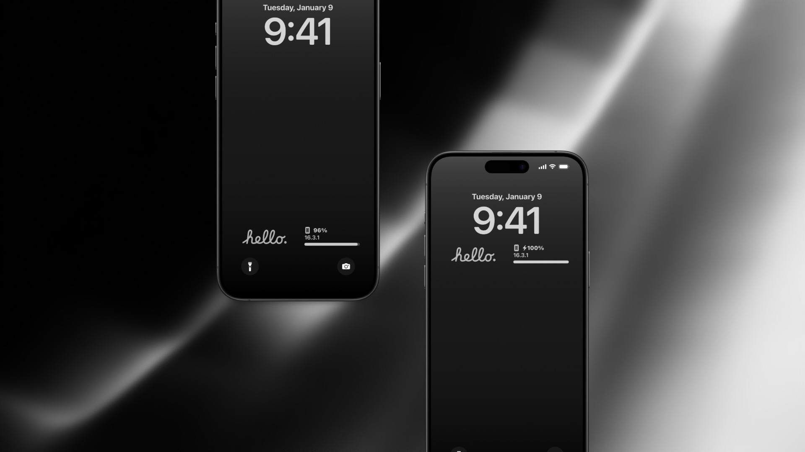
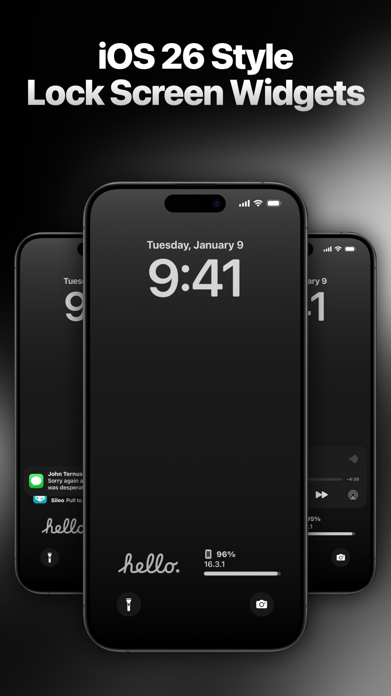
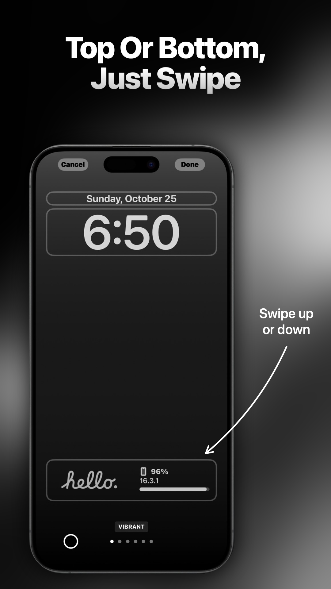
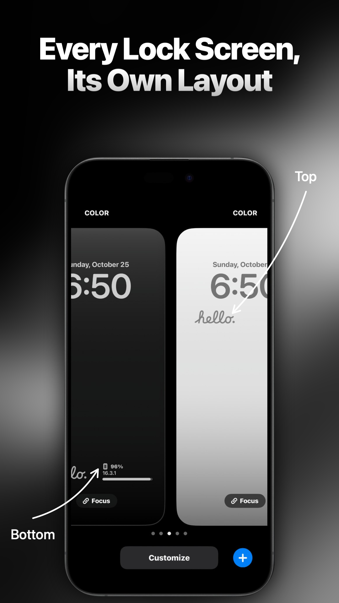
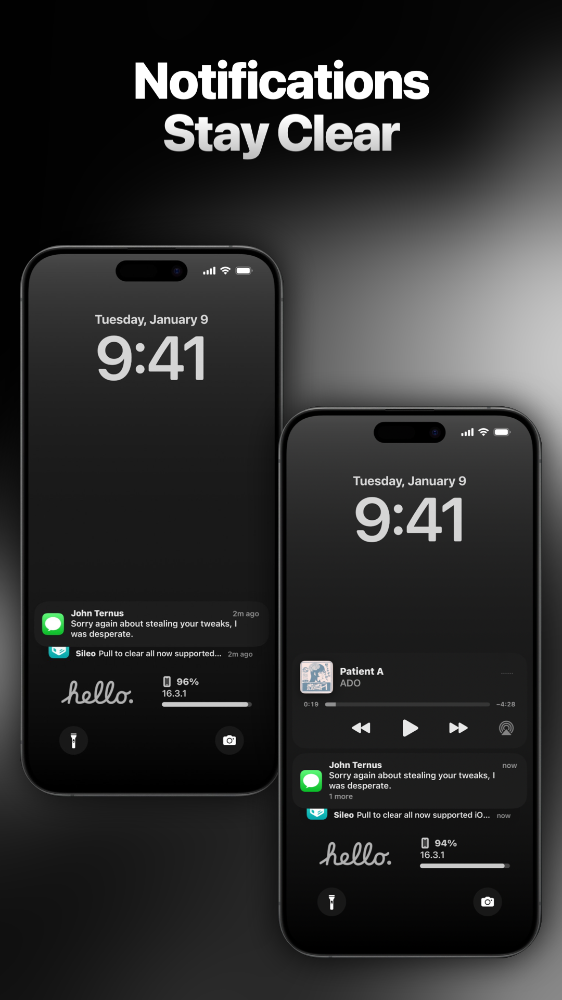

  

<h1 align="center">Soko</h1>

  
  
  
  
  

## About

Soko brings the iOS 26 widget layout to your Lock Screen on iOS 16-18. Your widgets sit at the bottom of the screen, just above the flashlight and camera buttons, instead of under the clock.

## Features

- Customize a Lock Screen and swipe the widget row down to move it to the bottom, or up to put it back under the clock.
- Each Lock Screen remembers its own layout, so you can keep different layouts on different wallpapers.
- Widgets line up with the flashlight and camera buttons, just like on iOS 26.
- Notifications stay above your widgets, so nothing gets covered.
- See the widget row where it will appear while you customize.

## Open source

Soko is open source under the [GNU GPLv3 license](LICENSE). You can explore the code, contribute improvements, or [report an issue](https://github.com/waruhachi/Soko/issues).

## Support development

Soko is free on [GitHub](https://github.com/waruhachi/Soko/releases). If you'd like to support me and Soko's development, you can buy it on [Havoc](https://havoc.app/package/soko). **The paid and free versions will always have the same features and functionality, with no paid-exclusive features.**

## Screenshots

  
  

  
  

